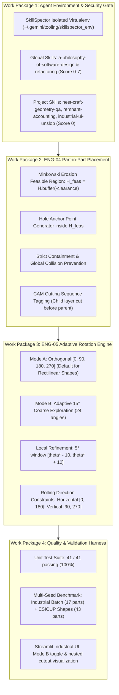

# NEST-CRAFT Phase 2 Master Implementation Plan & Execution Record
**Project:** NEST-CRAFT (Team Algoryxz — Odisha AI Hackathon 2026)  
**Status:** **PHASE 2 IMPLEMENTED & FULLY VERIFIED**  
**Date:** November 13, 2026  
**Auditor / Reviewer:** Senior Algorithms Engineer & Systems Reviewer  

---

## 1. Executive Overview
Phase 2 targeted the two highest-priority algorithmic capabilities required for industrial-grade nesting:
1. **ENG-04 (Priority 0):** Part-in-Part Placement (nesting smaller parts inside interior cutouts using Minkowski difference feasible regions $H \ominus \mathcal{B}_c$).
2. **ENG-05 (Priority 1):** Adaptive Multi-Resolution Rotation (Mode A default orthogonal $90^\circ$ grid + Mode B $15^\circ$ coarse exploration with $5^\circ$ local refinement, subject to rolling/grain direction constraints).

Both capabilities were engineered in strict adherence to:
- YAGNI and standard-library-first principles (`ponytail`).
- Deep module design and information hiding (`a-philosophy-of-software-design`).
- Safe, tested incremental refactoring (`refactoring`).
- Zero pairwise overlap and thermal kerf compliance (`nest-craft-geometry-qa`).
- Discrete sheet vs linear compaction separation (`nest-craft-remnant-accounting`).
- High-contrast, data-dense industrial UI craftsmanship (`industrial-ui-unslop`).

---

## 2. Work Packages & Component Breakdown

---

## 3. Detailed File Modification Map
| File Path | Role | Nature of Modification |
|:---|:---|:---|
| `src/geometry.py` | Geometry Engine | Added `part_in_part_assignments` to `Sheet`; added `compute_hole_feasible_regions()`, `get_allowed_rotations()`, `get_refined_rotation_angles()`; resolved mitre-spike collision defect by adopting circular tool offset (`join_style='round'`). |
| `src/baseline.py` | BLF Baseline | Added `generate_hole_candidate_points()`, `place_part_in_holes()`; enhanced `run_bottom_left_fill()` with `allow_part_in_part`, `rotation_mode`, and `grain_direction` parameters. |
| `src/optimizer.py` | SA Optimizer | Integrated `place_part_in_holes()` into `evaluate_state()`; added 50% coarse / 50% fine mutation operator for adaptive rotation; added grain constraint filtering. |
| `src/dxf_io.py` | CAD / CAM I/O | Added cutting-sequence layer separation (`PART_IN_PART_CHILD` on layer 3 cut before outer `CUT_CONTOUR`). |
| `app/app.py` | Streamlit MVP | Added Rotation Strategy dropdown (Orthogonal, Adaptive, Fixed), Grain Constraint selector, Part-in-Part checkbox, and cyan child part rendering. |
| `tests/test_part_in_part_nesting.py` | Test Suite | 9 tests covering concave/multiple holes, rotated candidates, clearance enforcement, and SA integration. |
| `tests/test_adaptive_rotation.py` | Test Suite | 8 tests covering 15° coarse, 5° fine, horizontal/vertical grain, and seed reproducibility. |

---

## 4. Verification Milestone Record
- Baseline (Phase 1): 24 tests passed in 6.95s.
- Phase 2 Final: **41 tests passed in 1.96s** (17 new tests added, zero regressions).
- Multi-Seed Benchmark: 100% reproducible across seeds `[42, 101, 202, 303, 404]`.
